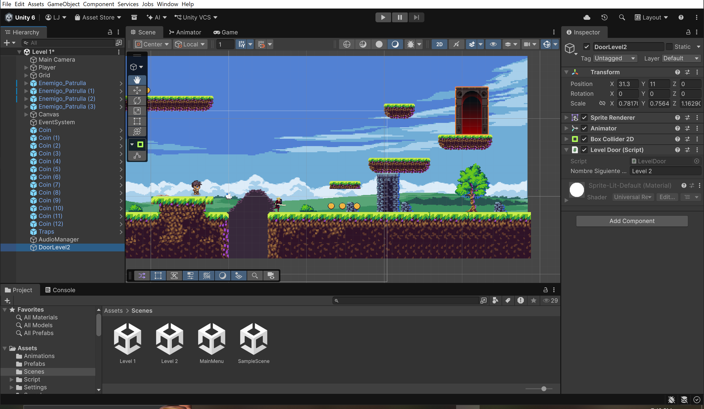
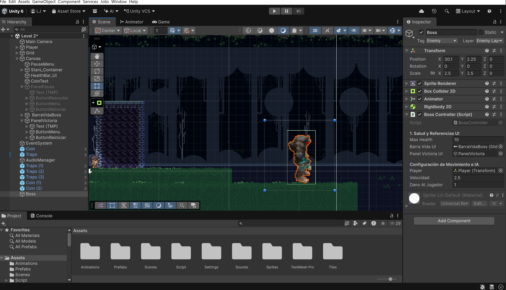
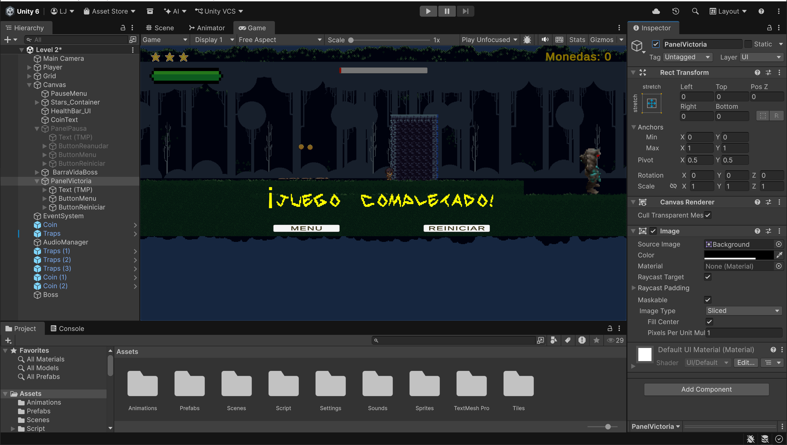

# 🎮 Taller 10: Jefe Final (Boss Fight), Nivel 2, Victoria
# The Wandering Knight - 2D Platformer

> **Aviso Académico:** Este proyecto ha sido desarrollado exclusivamente con fines formativos y académicos dentro del curso de Diseño y Desarrollo de Videojuegos 2D. Todos los recursos empleados se utilizan con propósito educativo.

Proyecto desarrollado en Unity 2D (Unity 6). En este taller se implementa la conclusión y cierre del videojuego: la creación de la escena del **Nivel 2** despejada para el combate, el sistema de transición mediante portales (`LevelDoor.cs`), la programación del Jefe Final (`BossController.cs`) con inteligencia artificial de persecución y sincronización con una barra de vida roja en la UI, el sistema de **Fase de Furia** (activación de color rojo y aumento de velocidad al bajar del 50% de salud), y el diseño del **Panel de Victoria** (`PanelVictoria`) que congela el tiempo y ofrece opciones de reinicio o retorno al menú principal.

---

## 📹 Video de Demostración
- **Video en Google Drive:** [Ver Video Demostrativo - Taller N° 10](https://drive.google.com/file/d/17ACqivzue1cSNWPvpd9fMyySt6O-Y1Pn/view?usp=sharing)

---

## 🖼️ Evidencias del Proyecto

### 1. Portal de Transición en Nivel 1 (Door_Level1)
Configuración del objeto `DoorLevel2` con componente `BoxCollider2D` activado como `Is Trigger` y el script `LevelDoor.cs` para viajar al Nivel 2:


### 2. Configuración del Jefe Final (Boss Arena)
Instanciación del objeto `Boss` en el Nivel 2 con escala adaptada, componentes de físicas, capa de colisión y el script `BossController.cs` vinculado a su barra de vida en la UI:


### 3. Pantalla de Victoria (Panel_Victoria)
Panel modal integrado en el Canvas del Nivel 2 con título estilizado en TextMeshPro y botones interactivos conectados a los eventos de reinicio y menú principal:


---

## 🚀 Características Implementadas

1. **Escena del Nivel 2 y Transición de Niveles (`LevelDoor.cs`):**
   - Duplicación y registro formal de la escena `Level 2` en el índice 2 de *Build Profiles / Build Settings*.
   - Limpieza de enemigos menores en el Nivel 2 para estructurar una arena de combate exclusiva para el jefe.
   - Creación del script `LevelDoor.cs` para detectar las colisiones del jugador con el portal y cargar de forma fluida el siguiente nivel.

2. **Jefatura y Inteligencia Artificial (`BossController.cs`):**
   - Configuración del objeto `Boss` con salud máxima de `10` y vinculación con la barra de vida de la UI (`BarraVidaBoss`).
   - Persecución autónoma en el eje horizontal mediante `Rigidbody2D.MovePosition`.
   - Sistema dinámico de **Fase de Furia**: al descender la salud al 50% o menos (`currentHealth <= maxHealth / 2`), el sprite cambia a color rojo intenso y su velocidad de persecución incrementa un 80%.
   - Daño por colisión directa al interactuar con el componente `PlayerHealth` del personaje.

3. **Pantalla de Victoria y Control de Flujo de Juego:**
   - Creación del `PanelVictoria` en el Canvas de la escena, configurado para iniciar oculto por defecto.
   - Activación autónoma al cumplirse la condición de derrota del jefe (`currentHealth <= 0`), ejecutando `panelVictoriaUI.SetActive(true)` y congelando el tiempo del entorno con `Time.timeScale = 0f`.
   - Conexión de eventos `OnClick()` en los botones para reiniciar la partida o retornar con seguridad al menú principal.

---

## 🛠️ Cómo Abrir el Proyecto en Unity

1. Clona este repositorio o descarga el archivo ZIP:
   ```bash
   git clone [https://github.com/luisAristeguieta/videoJuego10.git](https://github.com/luisAristeguieta/videoJuego10.git)

2. Abre Unity Hub.
3. Haz clic en Add > Add project from disk.
4. Selecciona la carpeta raíz del repositorio clonado.
5. Abre el proyecto con Unity 6 (o versión compatible).
6. Dirígete a Assets/Scenes/ y abre la escena principal Level 1.unity (o la inicial MainMenu.unity).
7. Presiona Play para atravesar el portal del Nivel 1, enfrentarte al Jefe en el Nivel 2 y comprobar el sistema de combate, furia y pantalla de victoria.